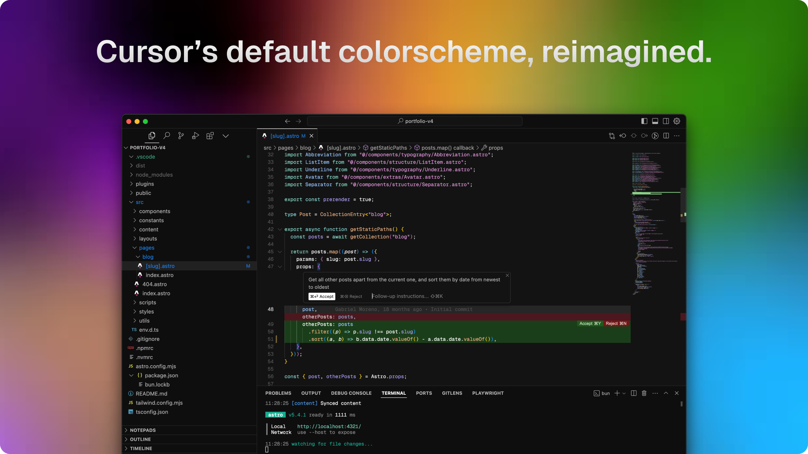

# Anysphere Code

Cursor's Anysphere theme for VS Code.



## Install

Build and install locally:

```sh
npx @vscode/vsce package
code --install-extension anysphere-code-0.1.0.vsix
```

Then pick **Anysphere Dark** under Preferences > Color Theme.

## Credits

Based on [cursor-anysphere-theme](https://github.com/hasokeric/cursor-anysphere-theme) by hasokeric.

## License

MIT. See [LICENSE](LICENSE).
